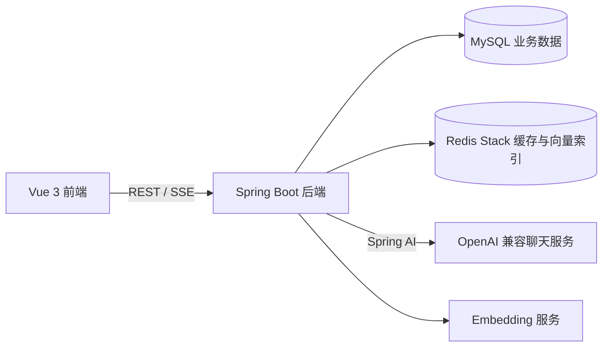

# 智面 · ZhiMian

基于 **Spring Boot 3、Spring AI 和 Vue 3** 的 AI 面试训练平台，将题库练习、模拟面试、错题复习和知识库检索串成一套学习流程。

你可以先浏览题库、记录练习结果，再按技术方向或综合场景进行文字模拟面试，通过流式反馈、面试报告和带知识来源的错题讲解定位薄弱点。

## 目录

- [功能概览](#功能概览)
- [技术栈与架构](#技术栈与架构)
- [快速开始](#快速开始)
- [模型与知识库配置](#模型与知识库配置)
- [配置参考](#配置参考)
- [数据库与数据保留](#数据库与数据保留)
- [项目结构](#项目结构)
- [接口与开发检查](#接口与开发检查)
- [常见问题](#常见问题)

## 功能概览

| 模块 | 已实现能力 |
| --- | --- |
| 题库中心 | 题目分页、分类与标签筛选、关键词检索、难度区分、题目详情和热门题目 |
| 练习记录 | 提交练习结果，汇总学习数据、每日目标进度与趋势 |
| 模拟面试 | 包含 Spring 的技术专项与综合场景模式，支持美团、腾讯、小红书、阿里、蚂蚁和京东风格的模拟场景，配置 5～12 题，文字回答与 SSE 流式反馈 |
| 面试记录 | 历史会话、对话记录、异步生成的面试报告与评分反馈 |
| 错题本 | 记录错题、切换掌握状态、移除错题，生成包含关键点和复习建议的讲解 |
| 收藏与排行 | 收藏题目、管理个人收藏、查看答题排行榜 |
| 模型设置 | 管理员保存本人模型名和 API Key、测试连接、清除配置；Key 加密后存储 |
| 知识库管理 | 管理员导入 Markdown / 纯文本，异步分块与向量化，查看处理状态、重试失败任务和测试检索 |
| RAG 辅助学习 | 检索知识片段，为错题讲解和面试回答评价提供依据；讲解可展示知识引用与降级原因 |
| AI 题目审核 | 管理员审核面试过程中收集的候选题目，通过后入库或忽略 |
| 账号与权限 | 注册、登录、退出，JWT 鉴权，普通用户与管理员权限区分 |

题库、分类、标签、热门题和排行榜接口支持公开访问；个人学习数据、面试和收藏需要登录。模型设置、知识库与候选题审核需要管理员权限；企业风格场景为模拟训练，不代表企业官方题库。

## 技术栈与架构

| 层次 | 技术 |
| --- | --- |
| 后端 | Java 17、Spring Boot 3.5.3、MyBatis 3.0.4 |
| AI | Spring AI 1.0.0、OpenAI 兼容聊天 / Embedding 接口 |
| 数据存储 | MySQL 8.0、Redis Stack、Spring AI Redis Vector Store |
| 身份与密钥 | JJWT、BCrypt、AES-GCM 用户 API Key 加密 |
| 前端 | Vue 3、TypeScript、Vue Router、Pinia、Element Plus、Tailwind CSS 4 |
| 构建与测试 | Maven、Vite 8、vue-tsc、JUnit 5、Mockito |



知识入库按“文本清洗 → Markdown 章节 / Token 窗口分块 → Embedding → 向量写入”处理。MySQL 保存文档、分块和处理状态，Redis Stack 保存检索向量；检索结果还会结合数据库中的有效分块进行筛选。

## 快速开始

### 1. 准备环境

| 依赖 | 要求 / 建议 |
| --- | --- |
| JDK | 17 |
| Maven | 建议 3.9.x |
| Node.js | Vite 8 要求 `^20.19.0 || >=22.12.0`，建议使用满足要求的 LTS 版本 |
| npm | 随 Node.js 安装，用 `npm ci` 按锁文件安装依赖 |
| Docker | Docker Engine / Docker Desktop 已启动，支持 `docker compose` 与 `--wait` |

Compose 启动的是 MySQL 和 Redis Stack；后端与前端分别在本机启动。

### 2. 下载项目并启动基础服务

```bash
git clone https://github.com/a2874995779-del/ZhiMian.git
cd ZhiMian
docker compose up -d --wait
```

### 3. 启动后端

在项目根目录执行：

```bash
mvn spring-boot:run "-Dspring-boot.run.profiles=dev"
```

请显式启用 `dev`。基础配置默认激活 `local`，而仓库提供的本地 Compose 配套配置位于 [application-dev.yml](src/main/resources/application-dev.yml)。

### 4. 启动前端

另开终端，进入项目根目录后执行：

```bash
cd frontend
npm ci
npm run dev
```

| 服务 | 默认地址 / 端口 |
| --- | --- |
| 前端 | [http://localhost:5173](http://localhost:5173)，以 Vite 实际输出为准 |
| 后端 | [http://localhost:8080](http://localhost:8080) |
| 存活检查 | [http://localhost:8080/api/health](http://localhost:8080/api/health) |
| MySQL | `127.0.0.1:23307`，数据库 `zhimian` |
| Redis Stack | `127.0.0.1:26380` |

前端开发服务器将 `/api` 代理到 `http://localhost:8080`。存活检查返回 `data: "UP"`，只用于确认应用能够响应，不会验证数据库、Redis 或模型服务的完整可用性。

### 5. 开始使用

首次初始化数据库会导入示例题库和演示管理员 **`admin / admin123`**；普通用户可以在界面中注册。

建议先浏览题库、记录练习结果。管理员可以进入“模型设置”保存本人的模型名和 Key、测试连接，再开始模拟面试，也可以导入知识文档、测试检索和审核 AI 候选题。普通用户不能编辑模型配置；AI 功能仍要求该用户已经有可用的模型配置，不会自动借用管理员的 Key。

## 模型与知识库配置

### 聊天模型：用户配置与服务端配置

当前面试对话、报告生成和错题 AI 讲解通过 `AiChatClientFactory` 读取**当前用户保存的模型名和 API Key**，并使用服务端统一配置的聊天 `base-url`。

1. 服务端用 `OPENAI_BASE_URL` 指定 OpenAI 兼容服务，默认 `https://api.deepseek.com`。
2. 管理员登录后进入“模型设置”，填写该服务支持的完整模型 ID，例如 DeepSeek 官方接口的 `deepseek-chat`，以及对应 Key。其他服务商的模型 ID 以其接口说明为准。
3. 保存并测试连接后，再使用 AI 功能。

`OPENAI_API_KEY`、`OPENAI_CHAT_MODEL` 用于 Spring AI 默认聊天模型配置，**不会替代上述用户配置**。当前页面不提供每个用户独立设置 `base-url` 的功能；更换服务商时，需要同步调整服务端地址与用户模型 / Key。

PowerShell 示例：在启动后端的同一个终端中设置变量，再启动服务。

```powershell
$env:OPENAI_BASE_URL = "https://api.deepseek.com"
mvn spring-boot:run "-Dspring-boot.run.profiles=dev"
```

`dev` 中的占位 Key 允许先体验基础功能，不代表真实 AI 请求已经可用。

保存或测试模型配置默认要求 HTTPS，本地回环地址允许开发调试。如确需临时允许管理员通过 HTTP 提交，可设置 `ZHIMIAN_AI_ALLOW_ADMIN_HTTP=true`；这不会开放普通用户的编辑权限，也不会加密 HTTP 传输，上线应使用 HTTPS 并关闭该开关。

### Embedding 与 RAG 知识库

Embedding 使用独立的服务端凭据，不读取用户的聊天 Key。以下为 PowerShell 配置示例：

```powershell
$env:EMBEDDING_API_KEY = "替换为你的 Embedding Key"
$env:EMBEDDING_BASE_URL = "https://api.siliconflow.cn"
$env:RAG_EMBEDDING_MODEL = "BAAI/bge-m3"
$env:RAG_INITIALIZE_SCHEMA = "true"
mvn spring-boot:run "-Dspring-boot.run.profiles=dev"
```

首次初始化向量索引时需要调用 Embedding 服务获取向量维度，因此必须先准备有效凭据。索引建立后可把 `RAG_INITIALIZE_SCHEMA` 设回 `false`，后续使用同一索引。

管理员进入“知识库管理”选择 `.md`、`.markdown` 或 `.txt` 文件，也可以填写文本内容；等待文档处理完成后再测试检索。当前支持 Markdown 和纯文本，不包含 PDF / Word 解析。

默认索引为 `zhimian-knowledge`，前缀为 `zhimian:knowledge:`。更换 Embedding 模型时应重新向量化知识文档；维度变化时还需使用匹配的新索引，并同步检查 `zhimian.rag.embedding-dimensions` 等配置。

错题讲解在没有相关知识或检索异常时可以降级为纯模型讲解；AI 生成失败时返回题库参考答案，并标明降级原因。

## 配置参考

完整配置见 [application.yml](src/main/resources/application.yml) 和 [application-dev.yml](src/main/resources/application-dev.yml)。以下默认值以 `dev` 为准。

| 环境变量 | 用途 | 默认值 / 说明 |
| --- | --- | --- |
| `SPRING_DATASOURCE_URL` | JDBC 地址 | 本机 `23307` 端口的 `zhimian` 数据库 |
| `SPRING_DATASOURCE_USERNAME` | 数据库用户 | `zhimian` |
| `SPRING_DATASOURCE_PASSWORD` | 数据库密码 | 本地开发值见 `application-dev.yml` |
| `SPRING_DATA_REDIS_HOST` | Redis 地址 | `localhost` |
| `SPRING_DATA_REDIS_PORT` | Redis 端口 | `26380` |
| `OPENAI_BASE_URL` | 统一聊天服务地址 | `https://api.deepseek.com` |
| `OPENAI_API_KEY` | 默认聊天模型 Key | 占位值 `local-not-configured`；业务 AI 功能仍需用户配置 |
| `OPENAI_CHAT_MODEL` | 默认聊天模型名 | `deepseek-chat`；业务调用使用用户保存的模型名 |
| `EMBEDDING_API_KEY` | Embedding 服务 Key | 占位值 `local-not-configured` |
| `EMBEDDING_BASE_URL` | Embedding 地址 | `https://api.siliconflow.cn` |
| `RAG_EMBEDDING_MODEL` | Embedding 模型及入库模型标记 | `BAAI/bge-m3` |
| `RAG_INITIALIZE_SCHEMA` | 是否初始化 Redis 向量索引 | `false` |
| `ZHIMIAN_JWT_SECRET` | JWT 签名密钥 | 自定义部署应设置独立且至少 32 字节的密钥 |

用户模型 Key 的加密密钥由 JWT 签名密钥派生。已保存用户 Key 后应保持签名密钥稳定；更换密钥会影响旧登录令牌与已加密 Key 的读取，需要重新登录并重新保存模型 Key。

`zhimian.interview.inactive-timeout-minutes` 默认 `120`：面试长时间没有成功完成一轮回答，会自动结束且不生成报告。其他 RAG 分块、检索与线程池参数可在配置文件及 `RagProperties` 中查看。

## 数据库与数据保留

| 文件 | 用途 |
| --- | --- |
| [sql/init.sql](sql/init.sql) | 新数据库的完整表结构 |
| [sql/test-data.sql](sql/test-data.sql) | 示例分类、标签、题库和管理员账号 |
| `sql/migrate-*.sql` | 已有数据库按功能升级的脚本 |
| [sql/import-interview-qa.sql](sql/import-interview-qa.sql) | 额外题库导入脚本，按需使用 |

MySQL 首次使用空数据目录时，Compose 自动依次执行 `init.sql` 和 `test-data.sql`；已有数据卷再次启动不会重跑初始化。`test-data.sql` 会清空题目、分类、标签及关联表，并重建 `admin` 账号，仅适合可重建的演示数据库。新库已包含当前表结构，无需重复执行迁移脚本；旧库应对照现有结构选择迁移，避免重复增加字段。

```bash
# 停止基础服务并保留容器
docker compose stop

# 再次启动
docker compose up -d --wait
```

Compose 为 MySQL 显式配置了 `mysql-data` 命名卷，当前完整开发方案没有为 Redis 声明持久化卷。需要保留向量数据时，应补充 Redis 持久化配置并配合备份；不要把 `stop`、删除容器和删除卷视为相同操作。

[docker-compose.rag.yml](docker-compose.rag.yml) 是另一套仅启动 RAG Redis 的方案，宿主机端口为 `6380`，带独立数据卷，适合搭配已有 MySQL 使用。它不会自动替换 `dev` 中的 `26380` 端口，选用时需要同步调整 Redis 配置。

## 项目结构

```text
ZhiMian/
├── frontend/                         # Vue 3 前端
│   └── src/
│       ├── api/                      # HTTP 与流式接口调用
│       ├── components/               # 题库、错题、布局等组件
│       ├── router/                   # 路由与页面权限
│       └── views/                    # 题库、面试、知识库等页面
├── src/main/java/com/zhimian/
│   ├── ai/                           # 用户聊天模型客户端
│   ├── controller/                   # API 入口
│   ├── service/                      # 业务与面试流程
│   ├── rag/                          # 入库、分块、检索与生成
│   ├── security/                     # 用户 Key 加密
│   └── mapper/                       # MyBatis Mapper
├── src/main/resources/
│   ├── mapper/                       # SQL 映射
│   └── application*.yml              # 配置
├── src/test/                         # 单元、集成及检索评估测试
├── sql/                              # 建表、演示数据与迁移
├── compose.yml                       # 本地 MySQL + Redis Stack
└── docker-compose.rag.yml             # 独立 RAG Redis 方案
```

## 接口与开发检查

以下为主要接口入口，完整字段与权限以 `controller` 和 DTO 为准。需要登录的请求使用 `Authorization: Bearer <token>`。

| 接口 | 用途 |
| --- | --- |
| `POST /api/auth/register`、`POST /api/auth/login` | 注册、登录 |
| `GET /api/questions` | 题库列表 |
| `POST /api/questions/{id}/answer` | 提交练习结果 |
| `POST /api/interviews` | 创建面试 |
| `POST /api/interviews/{id}/chat` | SSE 流式面试对话 |
| `GET /api/interviews/{id}/report` | 查询报告状态与结果 |
| `POST /api/wrong-questions/{questionId}/explanation` | 生成错题讲解 |
| `PUT /api/user/ai-model` | 保存用户模型设置 |
| `POST /api/admin/knowledge-documents` | 提交知识文档入库 |
| `POST /api/admin/rag/search` | 测试知识检索 |

常规 JSON 响应包含 `code`、`message`、`data`，成功业务码为 `0`；流式对话使用 SSE，接入时需单独处理流事件。

```bash
# 在项目根目录运行后端测试
mvn test

# 在 frontend 目录进行类型检查与生产构建
cd frontend
npm run build
```

普通单元测试不需要真实模型 Key。以下测试默认由环境变量控制，启用前需准备独立测试数据和对应服务：

| 开关 | 外部依赖 |
| --- | --- |
| `RUN_RAG_DATABASE_TESTS=true` | 配置好的 MySQL 测试数据库 |
| `RUN_RAG_INTEGRATION_TESTS=true` | Redis Stack 与真实 Embedding 服务；当前测试断言 BGE-M3 的 1024 维向量 |
| `RUN_RAG_EVALUATION_TESTS=true` | 数据库、Redis Stack、Embedding 及已准备的知识库数据 |

生产构建产物位于 `frontend/dist/`。Vite 的开发代理不包含在静态产物中，部署时需要为 `/api` 配置后端转发，并让反向代理及时转发 SSE 数据。

## 常见问题

| 现象 | 检查方式 |
| --- | --- |
| 后端连不上本地数据库 / Redis | 确认 Compose 服务健康，并显式启用 `dev`；不要混用基础配置中的 `3306 / 6380` 与开发端口 |
| 能登录但 AI 无法回答 | 确认当前用户已有可用的模型配置；管理员可在“模型设置”保存并测试本人配置，同时检查服务端 `OPENAI_BASE_URL` 与模型 ID、Key 是否匹配 |
| 模型页面的服务商文字与实际配置不同 | 当前返回的服务商展示名固定为“SiliconFlow 兼容接口”，实际请求地址以服务端 `OPENAI_BASE_URL` 为准 |
| RAG 初始化或导入失败 | 检查 Embedding 凭据、模型、网络和 Redis Stack；普通 Redis 不具备所需的向量检索模块 |
| 导入成功但检索没有结果 | 确认文档处理完成，知识内容相关，且查询与入库使用一致的 Embedding 模型和索引 |
| 更改 JWT 密钥后用户模型不可用 | 重新登录并重新保存模型 Key，后续保持服务端密钥稳定 |
| `npm ci` / 构建提示 Node 版本问题 | 按 Vite 8 的版本范围检查；并非所有高于 20.19 的 Node 版本都符合其要求 |
| 与论坛项目一起运行出现 8080 冲突 | 修改一个后端的 `server.port`，同时更新该项目前端的代理目标 |
